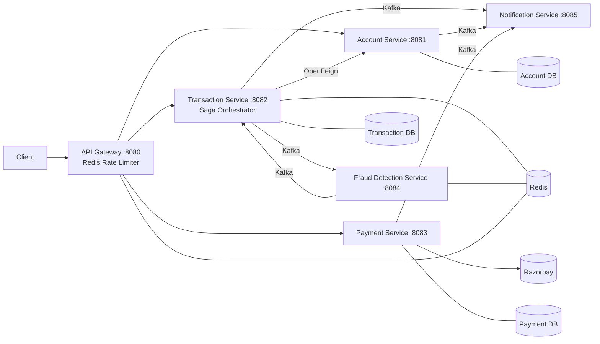
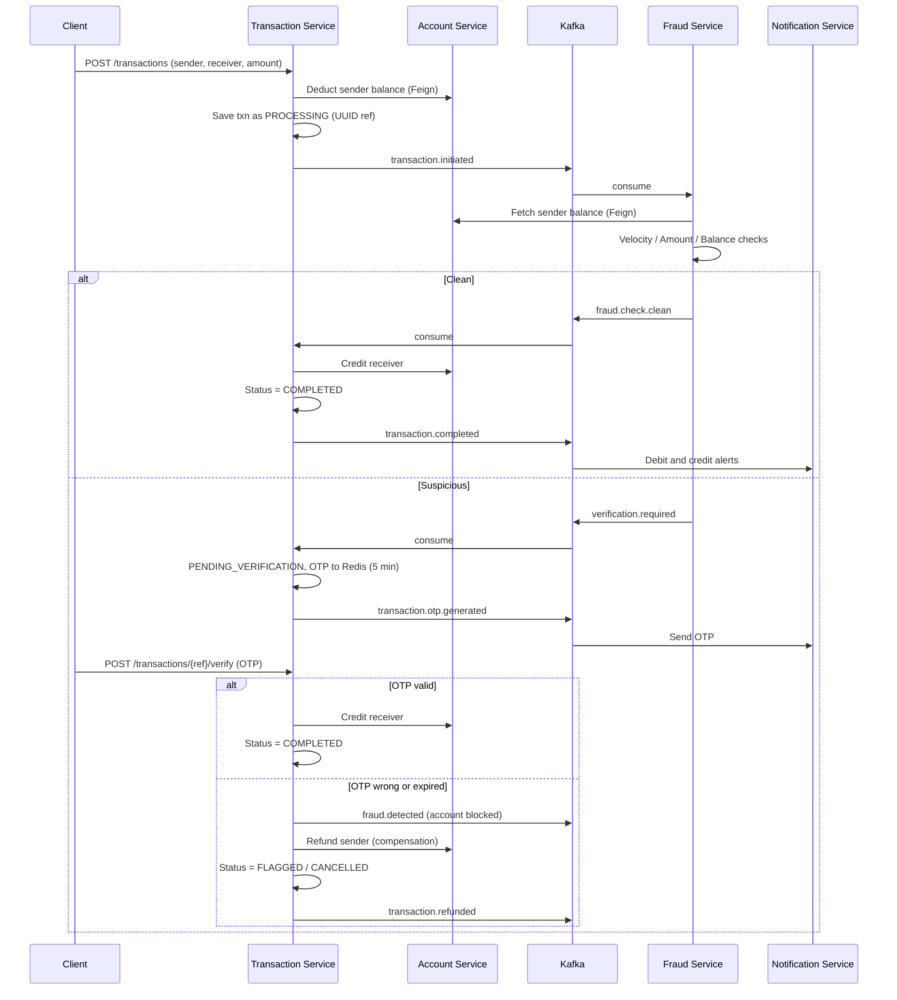

# SagaPay: Digital Banking System

> A production-style, event-driven digital banking platform built with Java, Spring Boot microservices, Apache Kafka and Redis. It features real-time fraud detection, OTP verification, and the **Saga Pattern** so that no transfer is ever left stuck halfway.


---

## Table of Contents

- [Why this project](#why-this-project)
- [Key features](#key-features)
- [Architecture](#architecture)
- [Money flow](#money-flow)
- [Saga pattern](#saga-pattern)
- [Fraud detection rules](#fraud-detection-rules)
- [Microservices](#microservices)
- [Kafka topics](#kafka-topics)
- [Tech stack](#tech-stack)
- [Getting started](#getting-started)
- [Project structure](#project-structure)
- [Roadmap](#roadmap)
- [Contributing](#contributing)
- [License](#license)
- [Acknowledgements](#acknowledgements)

---

## Why this project

Tapping "pay" and seeing money move in under two seconds hides two hard problems:

1. **Real-time fraud detection.** Fraudsters run scripts that fire dozens of transactions in seconds. Suspicious activity has to be caught in milliseconds, before the account is drained.
2. **Consistency across services.** In a monolith, `BEGIN / COMMIT / ROLLBACK` protects you. In microservices, every service owns its own database, so a failure midway cannot trigger a native rollback. SagaPay solves this with **explicit compensating transactions** (the Saga pattern).

## Key features

- **Account management**: unique 12-digit account numbers, account types, per-type daily limits
- **Fund transfers** with synchronous balance deduction and asynchronous completion
- **Saga orchestration** with compensating refunds when a step fails
- **Real-time fraud detection** (velocity, unusual amount, high balance usage)
- **OTP verification** for suspicious transfers (6 digits, 5-minute TTL in Redis)
- **Automatic account blocking** on failed or expired verification
- **Notifications**: debit/credit alerts, OTPs, fraud warnings, refund messages
- **External payments** via Razorpay with webhook handling
- **API Gateway** with Redis-backed rate limiting (10 req/s, burst 20)

## Architecture



Synchronous calls (OpenFeign) are used only where an immediate answer is required, such as deducting or refunding balance. Everything else flows through Kafka events.

## Money flow



### Transaction states

`PROCESSING` → `PENDING_VERIFICATION` → `COMPLETED`
                                      ↘ `FLAGGED` / `CANCELLED` (after refund)

Event handlers are **idempotent**. For example, `verification.required` is only acted on if the status is still `PROCESSING`.

## Saga pattern

SagaPay uses **orchestration**: the Transaction Service is the decider and drives every step. Each step that changes state has a defined compensating action.

| Step | Action | Compensation |
| :--- | :--- | :--- |
| 1 | Deduct sender balance | Credit sender (refund) |
| 2 | Publish `transaction.initiated` | Mark transaction cancelled |
| 3 | Fraud check / OTP verification | Block account and refund |
| 4 | Credit receiver | Reverse and refund sender |

Think of it like a Cash-on-Delivery return: a damaged item doesn't silently "un-happen". Returning it is its own explicit step that triggers a refund.

## Fraud detection rules

| Rule | Logic | Storage |
| :--- | :--- | :--- |
| **Velocity** | More than 5 transactions within 60 seconds | Redis counter with 60s TTL |
| **Unusual amount** | Amount exceeds 3x to 5x the running average of past transactions | Running average |
| **Balance usage** | Transfer exceeds 90% of total balance | Fetched from Account Service |

If any rule trips, the transfer moves to OTP verification instead of completing.

## Microservices

| Service | Port | Responsibility | Key tech |
| :--- | :--- | :--- | :--- |
| **API Gateway** | 8080 | Single entry point, rate limiting | Spring Cloud Gateway, Reactive Redis |
| **Account Service** | 8081 | Accounts, balances, debit/credit/refund, blocking | Spring Data JPA, MySQL, Kafka |
| **Transaction Service** | 8082 | Saga orchestrator, OTP generation and verification | OpenFeign, Redis, Kafka |
| **Payment Service** | 8083 | Razorpay orders and webhooks | Razorpay SDK, MySQL, Kafka |
| **Fraud Detection Service** | 8084 | Real-time rule engine | OpenFeign, Redis, Kafka |
| **Notification Service** | 8085 | Email alerts for all events | Java Mail, Kafka |

## Kafka topics

| Topic | Producer | Consumer(s) |
| :--- | :--- | :--- |
| `transaction.initiated` | Transaction | Fraud Detection |
| `fraud.check.clean` | Fraud Detection | Transaction |
| `verification.required` | Fraud Detection | Transaction |
| `transaction.otp.generated` | Transaction | Notification |
| `transaction.completed` | Transaction | Account, Notification |
| `transaction.refunded` | Transaction | Notification |
| `fraud.detected` | Transaction | Account (blocks account), Notification |
| `payment.completed` | Payment | Notification |
| `payment.failed` | Payment | Notification |

## Tech stack

- **Language / framework:** Java 17+, Spring Boot 3, Spring Cloud Gateway, Spring Data JPA
- **Messaging:** Apache Kafka + Zookeeper
- **Cache / rate limiting / OTP store:** Redis
- **Database:** MySQL (database per service)
- **Inter-service calls:** OpenFeign
- **Payments:** Razorpay
- **Mail:** Spring Boot Starter Mail
- **Build:** Maven, Lombok

## Getting started

### Prerequisites

- JDK 17+
- Maven 3.8+
- Docker (for Kafka, Zookeeper, Redis, MySQL)
- A Razorpay test account (for the Payment Service)
- An SMTP account (for the Notification Service)

### 1. Clone

```bash
git clone https://github.com/<your-username>/sagapay-digital-banking.git
cd sagapay-digital-banking
```

### 2. Start infrastructure

```bash
docker compose up -d   # Kafka, Zookeeper, Redis, MySQL
```

> A `docker-compose.yml` is on the roadmap. Until then, start each component manually with Docker.

### 3. Configure environment

Each service has an `application.yml`. Set secrets through environment variables and never commit them:

```bash
export RAZORPAY_KEY_ID=your_key_id
export RAZORPAY_KEY_SECRET=your_key_secret
export MAIL_USERNAME=your_email
export MAIL_PASSWORD=your_app_password
```

### 4. Run the services

Start them in this order:

```bash
cd account-service      && mvn spring-boot:run
cd transaction-service  && mvn spring-boot:run
cd fraud-detection-service && mvn spring-boot:run
cd notification-service && mvn spring-boot:run
cd payment-service      && mvn spring-boot:run
cd api-gateway          && mvn spring-boot:run
```

All client traffic goes through the gateway at `http://localhost:8080`.

### 5. Try it

```bash
# Example only: adjust paths and payloads to match your controllers
curl -X POST http://localhost:8080/api/transactions \
  -H "Content-Type: application/json" \
  -d '{"fromAccount":"<sender>","toAccount":"<receiver>","amount":500}'
```

## Project structure

```
sagapay-digital-banking/
├── api-gateway/
├── account-service/
├── transaction-service/
├── fraud-detection-service/
├── notification-service/
├── payment-service/
├── docs/                 # diagrams, screenshots
├── docker-compose.yml    # (planned)
├── .gitignore
├── LICENSE
└── README.md
```

## Roadmap

- [ ] `docker-compose.yml` for one-command local setup
- [ ] Spring Security + JWT authentication
- [ ] Outbox pattern for reliable event publishing
- [ ] Dead-letter queues and retry policies for Kafka consumers
- [ ] Distributed tracing (OpenTelemetry) and metrics (Prometheus / Grafana)
- [ ] Config server and service discovery
- [ ] Integration tests with Testcontainers
- [ ] CI pipeline (GitHub Actions)
- [ ] Kubernetes manifests

## Contributing

1. Fork the repo
2. Create a branch: `git checkout -b feature/your-feature`
3. Commit with clear messages: `git commit -m "feat: add X"`
4. Push and open a Pull Request

## License

Distributed under the MIT License. See `LICENSE` for details.

## Acknowledgements

Built while following a tutorial on building a complete digital banking system with microservices, Kafka, Redis and the Saga pattern. Add the video link here.